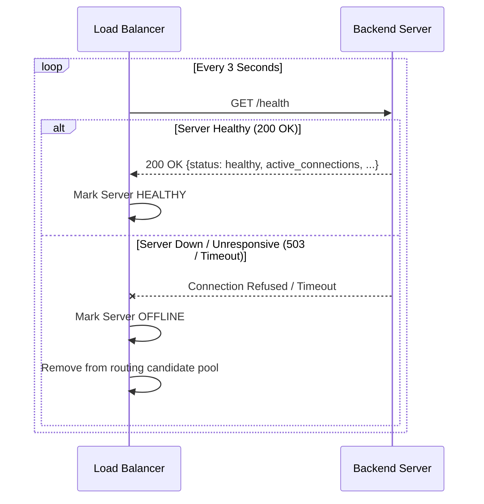

# LoadFlow — Interactive Load Balancing & Performance Monitoring Platform

A full-stack, distributed cloud computing demonstration platform designed to illustrate and benchmark cloud load-balancing algorithms, health checking mechanisms, and dynamic fault tolerance in real time.

---

## 📌 Project Overview

**LoadFlow** is an interactive, production-grade cloud computing project designed to demonstrate how incoming client traffic is routed across a cluster of backend microservices. Unlike static animations or mathematical simulations, **LoadFlow runs actual containerized application servers**, injects real processing delays, measures true TCP/HTTP round-trip latencies, dynamically monitors active connections, and performs active health-check probes.

The platform includes:
- **Interactive Cloud Dashboard** (React 19 + TypeScript + Vite + Recharts + Lucide Icons)
- **Central API Gateway & Load Balancer** (FastAPI + AsyncIO + WebSockets)
- **Heterogeneous Backend Server Fleet** (FastAPI instances with configurable base latencies, jitter, and failure injection)
- **Multi-Container Orchestration** (Docker & Docker Compose with custom bridge network)

---

## 🏛 System Architecture

```mermaid
graph TD
    Client[Web Browser / Dashboard] <-->|HTTP / WebSocket| LB[LoadFlow Load Balancer :8000]
    
    subgraph Container Fleet [Docker Bridge Network: loadflow-net]
        LB -->|HTTP Route & Health Check| S1[Backend Server 1 :8001<br/>Weight: 5 | Base Delay: 80ms]
        LB -->|HTTP Route & Health Check| S2[Backend Server 2 :8001<br/>Weight: 3 | Base Delay: 100ms]
        LB -->|HTTP Route & Health Check| S3[Backend Server 3 :8001<br/>Weight: 1 | Base Delay: 150ms]
        LB -->|HTTP Route & Health Check| S4[Backend Server 4 :8001<br/>Weight: 2 | Base Delay: 120ms]
    end

    Frontend[Nginx SPA Server :3000] -.->|Serves UI Assets| Client
```

### Component Details

1. **Load Balancer / API Gateway (`/load-balancer`)**:
   - Manages the backend server pool registry.
   - Evaluates load balancing algorithms per request.
   - Runs an asynchronous background health-check loop probing `/health` and `/metrics` every 3 seconds.
   - Streams live server telemetry and routing events to clients via persistent WebSockets (`/ws`).
   - Hosts a non-blocking asynchronous traffic generator and controlled multi-algorithm benchmark harness.

2. **Backend Server Fleet (`/backend-server`)**:
   - Lightweight FastAPI microservice containers (`server1`, `server2`, `server3`, `server4`).
   - Simulates heterogeneous hardware with different base response latencies (80ms to 150ms) and random jitter.
   - Tracks real-time active connections, request counters, uptime, and requests-per-second (RPS).
   - Exposes `/disable` and `/enable` endpoints to simulate server crashes and recoveries for fault tolerance testing.

3. **Frontend Dashboard (`/frontend`)**:
   - Single-Page Application (SPA) built with React 19, TypeScript, and Vite, served via Nginx in production.
   - Real-time connection status with auto-reconnecting WebSocket client.
   - Visual telemetry: Live request flow visualizer, response time trend lines, connection distribution bars, server load gauges.
   - Interactive controls: Algorithm switcher, single-shot request trigger, variable RPS burst generator, manual server kill/revive switches.
   - Algorithm benchmark suite comparing fairness, throughput, and latency.

---

## 🧠 Load Balancing Algorithms

LoadFlow implements four standard cloud routing algorithms:

### 1. Round Robin (RR)
- **Logic**: Requests are distributed cyclically across all healthy servers:
  $$\text{Server Index} = (\text{Request Number}) \pmod N$$
- **Characteristics**: Perfectly uniform request distribution assuming homogeneous server capacity and identical task sizes.
- **Limitation**: Ignores server capacity differences and existing queue depths.

### 2. Weighted Round Robin (WRR)
- **Logic**: Servers with higher assigned weights receive proportionally more requests. LoadFlow precomputes an interleaved execution schedule based on weights:
  $$P(\text{Server } i) = \frac{W_i}{\sum_{j=1}^{N} W_j}$$
- **Example**: With weights $S_1=5, S_2=3, S_3=1, S_4=2$, $S_1$ receives $\sim 45.5\%$ of all incoming traffic.
- **Characteristics**: Ideal for heterogeneous cloud clusters where instances have different CPU/memory sizing.

### 3. Least Connections (LC)
- **Logic**: Dynamic stateful algorithm that routes requests to the healthy server with the fewest active HTTP connections:
  $$\text{Selected Server} = \arg\min_{i} (\text{ActiveConnections}_i)$$
- **Characteristics**: Automatically compensates for long-running or computationally heavy requests by avoiding already saturated servers.

### 4. Weighted Least Connections (WLC)
- **Logic**: Normalizes the active connection count by the server's configured capacity weight:
  $$\text{Load Score}_i = \frac{\text{ActiveConnections}_i}{W_i}$$
  $$\text{Selected Server} = \arg\min_{i} (\text{Load Score}_i)$$
- **Characteristics**: Combines hardware capacity tiering with live workload monitoring; the industry standard for production reverse proxies (e.g., NGINX, HAProxy, AWS ALB).

---

## 🛡 Fault Tolerance & Health Probing



- **Active Health Checks**: The load balancer continuously probes each server's `/health` endpoint every 3 seconds.
- **Automatic Ejection**: If a backend server fails to respond or reports an unhealthy state, it is immediately marked `OFFLINE` and excluded from routing pools.
- **Zero-Downtime Re-admission**: As soon as a server passes health checks again, it is re-admitted without restarting the load balancer.
- **Graceful Degradation**: If all servers go offline, the load balancer gracefully returns an HTTP 503 response and informs connected clients over the WebSocket channel.

---

## 🚀 Quick Start Guide

### Option 1: Docker Compose (Recommended)

Make sure [Docker Desktop](https://www.docker.com/products/docker-desktop/) is installed and running.

1. **Clone or navigate to the project directory**:
   ```bash
   cd c:/Package
   ```

2. **Build and launch the complete multi-container stack**:
   ```bash
   docker compose up --build
   ```

3. **Open the Dashboard**:
   - Frontend UI: [http://localhost:3000](http://localhost:3000)
   - Load Balancer API & Swagger Docs: [http://localhost:8000/docs](http://localhost:8000/docs)

4. **Shutdown the cluster**:
   ```bash
   docker compose down
   ```

---

### Option 2: Local Development Setup (Without Docker)

#### 1. Backend Servers
Run four separate instances with different ports and IDs:
```bash
# Terminal 1 (Server 1)
cd backend-server
SERVER_ID=server-1 SERVER_PORT=8001 BASE_DELAY_MS=80 uvicorn app.main:app --port 8001

# Terminal 2 (Server 2)
cd backend-server
SERVER_ID=server-2 SERVER_PORT=8002 BASE_DELAY_MS=100 uvicorn app.main:app --port 8002

# Terminal 3 (Server 3)
cd backend-server
SERVER_ID=server-3 SERVER_PORT=8003 BASE_DELAY_MS=150 uvicorn app.main:app --port 8003

# Terminal 4 (Server 4)
cd backend-server
SERVER_ID=server-4 SERVER_PORT=8004 BASE_DELAY_MS=120 uvicorn app.main:app --port 8004
```

#### 2. Load Balancer
```bash
# Terminal 5
cd load-balancer
pip install -r requirements.txt
SERVER_1_URL=http://localhost:8001 SERVER_2_URL=http://localhost:8002 SERVER_3_URL=http://localhost:8003 SERVER_4_URL=http://localhost:8004 uvicorn app.main:app --port 8000 --reload
```

#### 3. Frontend
```bash
# Terminal 6
cd frontend
npm install
npm run dev
```
Open [http://localhost:5173](http://localhost:5173) in your browser.

---

## 🧪 Demonstration & Presentation Walkthrough

Follow these steps during a project presentation or demo:

| Step | Action | Expected Observation |
|---|---|---|
| **1. Baseline Round Robin** | Select **Round Robin** algorithm. Click **Send Request** 8 times. | Requests alternate sequentially: `S1 → S2 → S3 → S4 → S1 → S2...` with identical counts across all servers. |
| **2. Weighted Distribution** | Switch algorithm to **Weighted Round Robin**. Start traffic with 50 requests @ 10 RPS. | Observe Server 1 (Weight 5) receiving ~45% of traffic while Server 3 (Weight 1) receives only ~9%. |
| **3. Server Crash & Failover** | Click **Simulate Failure** on `server-2`. | Status changes to red `OFFLINE`. Upcoming requests bypass `server-2` entirely without dropping client requests. |
| **4. Self-Healing Recovery** | Click **Recover** on `server-2`. | Within 3 seconds, health check transitions status back to `HEALTHY`, and requests resume routing to `server-2`. |
| **5. Algorithm Benchmark** | Navigate to the **Compare** tab and click **Run Benchmark**. | Executes 100 test requests through all 4 algorithms and displays comparative fairness metrics, average response times, and per-server distributions side-by-side. |
| **6. Educational Concepts** | Navigate to the **How It Works** tab. | Review clear explanations of cloud architectural concepts demonstrated in the platform. |

---

## 📡 API Specification

| Method | Endpoint | Description |
|---|---|---|
| `GET` | `/api/servers` | Returns list of all registered backend servers and metrics |
| `GET` | `/api/servers/{id}` | Returns single server state and telemetry |
| `POST` | `/api/servers/{id}/stop` | Simulates server crash / failure injection |
| `POST` | `/api/servers/{id}/start` | Recovers / restores a server instance |
| `PUT` | `/api/servers/{id}/weight` | Updates the capacity weight of a server |
| `GET` | `/api/algorithm` | Gets the active load-balancing algorithm |
| `POST` | `/api/algorithm` | Sets the active algorithm (`round_robin`, `weighted_round_robin`, `least_connections`, `weighted_least_connections`) |
| `POST` | `/api/request` | Routes a single request through the active algorithm |
| `POST` | `/api/traffic/start` | Starts automated background traffic generator (`total_requests`, `requests_per_second`) |
| `POST` | `/api/traffic/stop` | Stops currently running traffic generation |
| `GET` | `/api/metrics` | Returns cluster-wide aggregated metrics |
| `GET` | `/api/logs` | Fetches filtered historical request logs |
| `POST` | `/api/logs/clear` | Clears request log history |
| `POST` | `/api/test` | Runs comparative benchmark across all algorithms |
| `WS` | `/ws` | Real-time WebSocket stream for metrics updates and routing events |

---

## 💻 Tech Stack Summary

- **Frontend**: React 19, TypeScript, Vite, Recharts, Lucide React, Glassmorphism Modern CSS
- **Backend / Load Balancer**: Python 3.12, FastAPI, Uvicorn, HTTPX, Pydantic v2, WebSockets
- **Deployment & Orchestration**: Docker, Docker Compose, Nginx Alpine, Multi-stage builds
